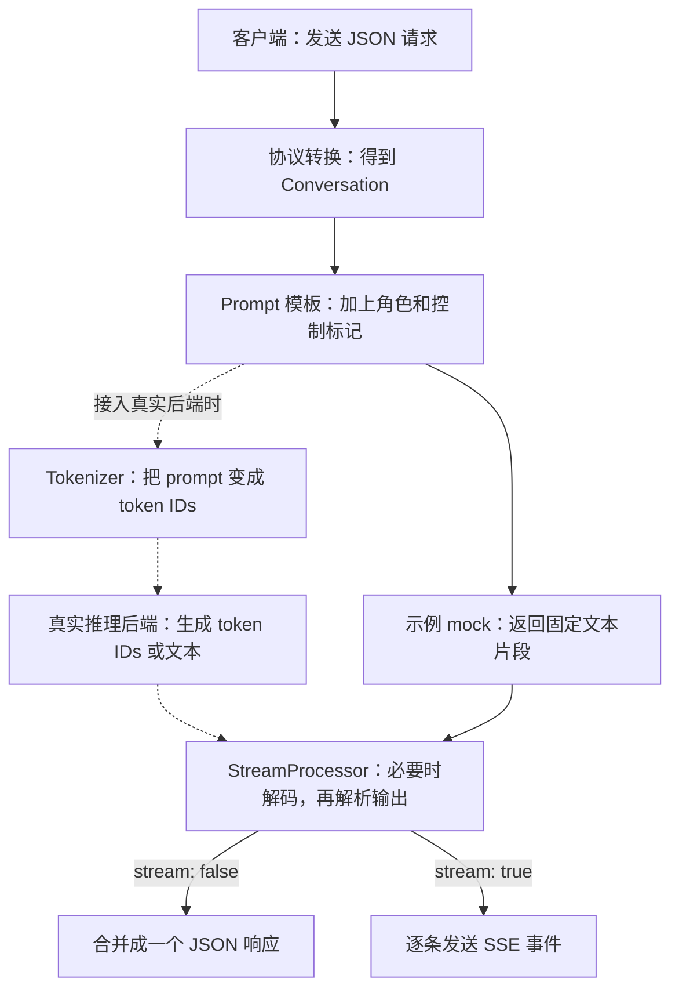

# 用 deepseek-recipe 入门大模型推理服务

如果想逐环节读源码、动手接入后端或解决 issue，可以从[推理服务实战教程](README.md)开始。

推理是让训练好的模型根据输入生成答案。一个推理服务还要处理模型前后的工作：接收请求，把对话变成模型能读的输入，再把模型输出整理成客户端能读的响应。

这个仓库实现了协议适配、输入编码和输出解析。示例服务器用 mock（模拟后端）返回固定文本。真正的模型计算、GPU 调度和外部工具执行由接入方提供。学习这里的流程不需要模型权重、GPU 或 API key。

## 1. 跟着一条请求走

以发送一条 `Hello` 消息为例。先看数据怎么变，再看代码放在哪里。



图例：实线是示例服务器的路径；虚线是接入真实后端时的概念路径。真实后端也可以负责分词和解码，再把文本交回服务。

| 环节 | 用这条请求理解它 | 到哪里看 |
| --- | --- | --- |
| 协议转换 | Chat Completions、Responses 和 Messages 的请求字段不同。转换后使用统一的 `ConversationRequest`，其中包含对话、模型版本和推理参数。 | [请求类型与转换接口](../deepseek-recipe/src/request/mod.rs) |
| Prompt 渲染 | Prompt 是送给模型的文本。模板把 `Hello` 放在用户角色后面，并标记接下来轮到助手回答。 | [V4.1 模板](../deepseek-recipe-encoding/src/v4/dsv41.rs)中的 `render_conversation` |
| Token 编码 | Token 是模型处理的文本单位。Tokenizer 把文本变成编号（token IDs）。模板和 tokenizer 都要与模型版本匹配。 | [Tokenizer 示例](../docs/tokenizer.zh.md) |
| 后端生成 | 真实后端用模型生成输出。示例中的 `mock_inference` 依次返回就绪、`Hello `、`world!` 和结束信号。 | [Python 示例服务器](../server-py/main.py) |
| 输出解析与返回 | `StreamProcessor` 把输出解析成对应 API 的片段，例如正文、推理内容和工具调用。服务器再决定合并成 JSON，还是用 SSE（服务端发送事件）逐条发出。 | [输出处理器](../deepseek-recipe/src/stream/processor.rs)、[流式示例](../docs/streaming.zh.md) |

这里有两种容易混淆的「解码」：后端的 decode 是逐步生成新 token；tokenizer 解码是把已有 token IDs 还原成文本。默认示例已经拿到了文本，因此跳过 tokenizer 解码。

## 2. 先看 prompt，再看输出怎么被拆开

从仓库根目录启动 [Encoding & Decoding Demo](../encoding-decoding-demo/README.md)。它需要仓库指定的 Rust 工具链和 C/C++ 编译器，无需 OpenCV。

```sh
cargo run -p encoding-decoding-demo --locked
```

打开 [本地 Demo](http://127.0.0.1:7778)，选择 Chat Completions。

1. 在 **Render** 中粘贴下面的请求。对比输入 JSON 与输出 prompt，找出用户和助手的角色标记。把 `thinking.type` 从 `enabled` 改为 `disabled` 再渲染一次，看看助手开头的标记如何变化。
2. 在 **Parse** 中粘贴 `<think>先确认问候语。</think>Hello!`。观察 `reasoning_content` 和 `content`。这段文本是手写的，Demo 只负责解析。然后试一下 Demo 的默认样例，看看工具名与参数怎样变成 `tool_calls`。

```json
{
  "model": "deepseek-flash",
  "messages": [{"role": "user", "content": "Hello"}],
  "thinking": {"type": "enabled"}
}
```

工具调用可以理解为模型给出的「请调用这个函数」请求。例如模型输出 `get_weather` 和城市参数，客户端执行函数，并把结果放入下一次请求。这个项目负责在协议和模型格式之间转换，不执行函数。

## 3. 对照一次性响应和流式响应

从仓库根目录启动 [Rust 示例服务器](../server-rs/README.md)。它需要 [OpenCV 等依赖](../docs/development.md#native-dependencies)。如果你更熟悉 Python，可以按 [Python 示例](../server-py/README.md)启动同一个端口；两个服务选一个即可。

```sh
cargo run -p server-rs --locked
```

在另一个终端发请求：

```sh
curl -sS http://127.0.0.1:7777/v1/chat/completions \
  -H 'Content-Type: application/json' \
  -d '{"model":"deepseek-flash","messages":[{"role":"user","content":"Hello"}],"thinking":{"type":"disabled"},"stream":false}'
```

`stream: false` 时，在 `choices[0].message.content` 看完整的 `Hello world!`。把 `stream` 改为 `true`，给 `curl` 加上 `-N` 关闭输出缓冲。此时查看多条 `data:` 事件，正文出现在 `choices[0].delta.content`，最后收到 `data: [DONE]`。一个 SSE 事件不一定对应一个 token，mock 也可能快到让事件看起来同时到达。

这里显式关闭 thinking，保证第一次实验直接得到正文。当前 Rust mock 固定发送 `Hello `、`world!`，不会补 `</think>`；省略 thinking 时默认开启思考，这些文字会进入 `reasoning_content`，正文为空。Python mock 会按 prompt 补结束思考标记，因此不能假设两种示例的默认结果完全相同。后面的 [Rust 思考实验](09-rust-practice.md)会复现这个差异。

接着打开 [server-py/main.py](../server-py/main.py)，按 `prepare_request → mock_inference → response_body` 读。重点看 `response_body`：它把后端片段送给同一个 `StreamProcessor`，再选择立即发送事件还是累积成完整响应。

## 4. 换成真实模型时，还要解决什么？

| 要学的内容 | 用一个例子理解 |
| --- | --- |
| 上下文预算 | 上下文窗口是模型一次能容纳的 token 数。假设上限是 1000，prompt 占了 800，显式要求最多生成 300 就会超限。接入方在编码后调用 `resolve_max_tokens` 做检查；未指定时，通常会用剩余空间限制默认值。 |
| 后端接入 | Python 示例可以用 `create_app(infer=...)` 换掉 mock。回调收到 `PreparedRequest`，逐段返回 `InferenceChunk`。当前示例没有给 processor 附加 tokenizer，所以回调应返回文本片段；想直接返回 token IDs，需要给 processor 附加匹配的 tokenizer。 |
| 推理性能 | 真实后端先处理输入并生成第一个 token（prefill），再逐步生成后续 token（decode）。KV cache 保存已处理 token 的注意力键和值，供后续步骤复用。首 token 延迟（TTFT）看从发出请求到收到第一个 token 要等多久。后续每 token 时间（TPOT）看后面生成得多快。mock 不能反映真实模型的这些指标。见 [DistServe 论文第 2 节](https://www.usenix.org/system/files/osdi24-zhong-yinmin.pdf)。 |

学完可以用三个问题自测：`Hello` 在哪里变成 prompt？换真实模型时从哪里接入？为什么两种 `stream` 模式能复用同一套输出解析？

---

[课程目录](README.md) · [下一章](01-request-conversion.md)
