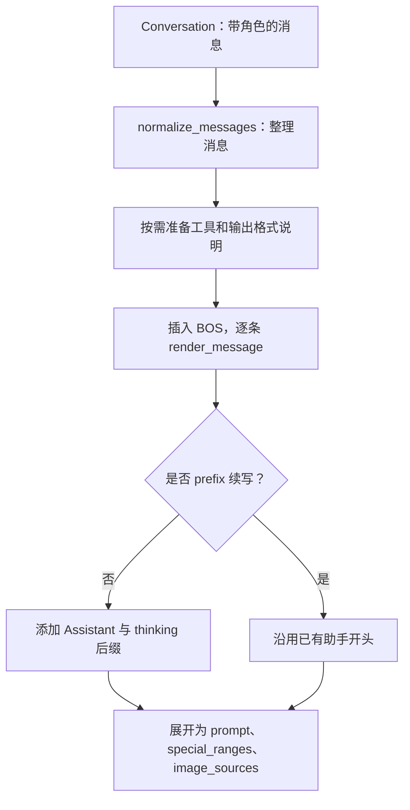

# 02 Prompt 模板：告诉模型谁在说话

Prompt 是送给模型的输入文本。用户的 `Hello` 只是其中一段。DeepSeek 模板还要放入控制标记，以区分消息角色并告诉模型从哪里开始生成。

```text
Conversation：用户说 Hello，关闭思考
    ↓ V4.1 render_conversation
<｜begin▁of▁sentence｜><｜User｜>Hello<｜Assistant｜></think>
```

对这条普通请求，开头标记表示序列开始；`<｜User｜>` 后面是用户内容；`<｜Assistant｜>` 表示轮到助手。关闭思考时，模板以 `</think>` 结束，模型从正文续写。打开思考时，结尾改为 `<think>`，生成的思考文本在后续遇到结束标记时切回正文。

## 先认识几个词

| 词 | 用 `Hello` 理解 |
| --- | --- |
| Chat template | 把带角色的消息排成某个模型熟悉的输入格式。`Hello` 会放在用户角色标记后。 |
| Special token | 模型词表中有特殊含义的 token。模板显式插入角色、序列开头、思考等标记。 |
| BOS / EOS | 一段序列的开始或结束标记。BOS 出现在这个 prompt 的起点。生成侧的 EOS 可用于终止生成，具体接入由后端处理。 |
| 续写（prefix continuation） | 最后一条助手消息提供开头，模型从那里接着生成。普通请求会另起一个助手回合。 |

先区分两个方向。渲染先给出助手回合的开头，例如 `<｜Assistant｜><think>`。后端往后续写时，可以再输出思考结束标记 `</think>` 和正文。输出解析器按初始状态区分这两类内容。

## 渲染返回什么？

[RenderedPrompt](../deepseek-recipe-encoding/src/lib.rs) 同时包含 `prompt`、`special_ranges` 和 `image_sources`。`special_ranges` 是模板显式写入的特殊标记在字符串里的字节区间，供 tokenizer 区分控制标记和普通文本。图片来源则按占位符出现的顺序排列。

例如用户输入 `请解释 <｜Assistant｜>`，用户写的这串字符仍是普通文本。它虽然和模板标记长得一样，却不在模板插入的控制区间里。自行把整个 prompt 当普通字符串分词，可能丢失这个区别。

## 把 prompt 拆成可核对的片段

继续运行第 01 章的 `basic` 场景。输入仍是同一条 Hello 请求，输出可以按下表读：

| 顺序 | 文本片段 | 来源 | 编码方式 |
| --- | --- | --- | --- |
| 1 | `<｜begin▁of▁sentence｜>` | 模板插入 | 特殊 ID |
| 2 | `<｜User｜>` | 模板插入 | 特殊 ID |
| 3 | `Hello` | 用户消息 | 普通 tokenizer |
| 4 | `<｜Assistant｜>` | 模板插入 | 特殊 ID |
| 5 | `</think>` | 关闭思考的模板后缀 | 特殊 ID |

`basic` 同时打印每个 `special_range` 的字节起止点和切出的字符串。先看文字，再看数字：这些区间只覆盖四个控制标记，不覆盖 `Hello`。

### 为什么字符串之外还需要 special_ranges？

可以把它理解为编辑器中的“格式信息”。同样显示为 `<｜Assistant｜>`，一处是模板指令，另一处可能是用户正在讨论的普通字符串。只保留显示文字就丢掉了来源。

输入渲染采用 `Prompt` 片段保存这种区别，最后展开成 `RenderedPrompt`。编码时，`PromptTokenizer` 对普通区间使用去掉 added vocabulary 的 tokenizer，对特殊区间查专门的 ID。它避免把用户提到的角色标记误编码成模板控制标记；这项机制不等同于防止所有自然语言 prompt injection。

### 一次渲染经过哪些步骤？



图对应 V4.1 的主要调用顺序，省略每种消息的格式细节。模板负责把已有对话排成模型熟悉的形式，不执行模型计算；切换模板也不会替后端加载对应权重。

### 修改一个条件，先预测结果

把用户文字换为 `请解释 <｜Assistant｜>`，再看 `special_ranges`。用户文字中的标记不应增加一个模板特殊区间。验收时检查区间切出的字符串及位置，不只用“prompt 里一共出现几次 Assistant”来判断。

然后再增加一轮 `user → assistant → user` 历史，观察模型输入包含整段历史。HTTP 服务收到这份请求时，不能仅凭“这是同一用户”就自动补齐之前的对话；应用需要按所用协议的支持范围提交历史。

## 跟读 Rust

从 V4.1 的 `render_conversation` 开始。它先用 `normalize_messages` 调整内部消息，例如合并连续的用户消息。需要工具提示或 JSON Schema 时，先把说明放进首条系统消息。随后插入 BOS，逐条调用 `render_message`。最后，普通请求还会走下面这段源码。 [dsv41.rs](../deepseek-recipe-encoding/src/v4/dsv41.rs)

```rust
if !is_prefix_continuation(&messages) {
    let assistant = self.components.special(SpecialToken::Assistant);
    let thinking_marker = self.components.special(if conversation.thinking_mode {
        SpecialToken::ThinkingStart
    } else {
        SpecialToken::ThinkingEnd
    });
    prompt += prompt!("{assistant}{thinking_marker}");
}
```

`&messages` 表示临时借用消息列表。`SpecialToken` 是枚举，`special` 根据枚举值创建带控制标记的片段。这里的 `prompt!` 是仓库里的 Rust 宏，用来拼接片段。继续读 `into_rendered_prompt`，看看带标记的片段如何变成 `prompt` 字符串和对应的 `special_ranges`。 [模板共用实现](../deepseek-recipe-encoding/src/v4/mod.rs) · [Prompt 片段类型](../deepseek-recipe-core/src/prompt.rs)

## 练习：只改变思考模式

沿用[上一章的 JSON](01-request-conversion.md#练习定位一个-400)，在 Demo 的 **Render** 中把 `thinking.type` 从 `disabled` 改成 `enabled`。定位 `Hello` 和助手标记，然后对比末尾的 `</think>` 与 `<think>`；思考开启时，其他位置也可随模板设置改变。

要修改渲染规则，先看 [V4.1 模板](../deepseek-recipe-encoding/src/v4/dsv41.rs)中的 `render_conversation` 与 `render_message`，再对照 [V4 模板](../deepseek-recipe-encoding/src/v4/dsv4.rs)。普通对话会添加新助手回合；Chat Completions 的 assistant `prefix: true` 是续写已有回合的高级路径。

## 进阶：续写与 Demo 解析

进阶时再读 `validate_prefix`。只有最后一条 assistant 消息能请求 prefix 续写，且它与工具上下文、部分输出格式有组合限制。普通对话完成本章练习后，再追这条路径。 [prefix 校验](../deepseek-recipe/src/protocol/openai/chat_completion/request/convert.rs)

Demo 的 Parse 接受整段助手输出，会先剥离开头的 `<｜Assistant｜>`、`<think>` 或 `</think>`，再按粘贴内容设置初始解析状态。直接使用库时，初始状态来自转换后的请求，通常只传 prompt 之后新生成的部分。比如 prompt 已以 `<think>` 结尾，后端可以从思考正文开始输出。 [Demo 的 parse_output](../encoding-decoding-demo/src/main.rs)

## 自测

用户消息里也写了 `<｜Assistant｜>`。怎样从渲染结果里判断哪一处是模板放入的角色标记？

<details>
<summary>参考答案</summary>

对照 `special_ranges`。模板插入的标记有对应字节区间，用户消息里的同样拼写仍属于普通文本。只看两个字符串的字面内容无法区分它们。

</details>

---

[上一章](01-request-conversion.md) · [课程目录](README.md) · [下一章](03-token-budget.md)
