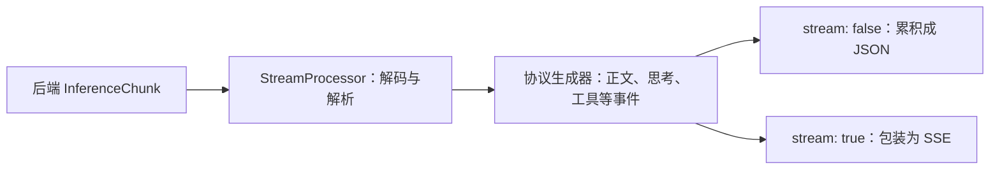
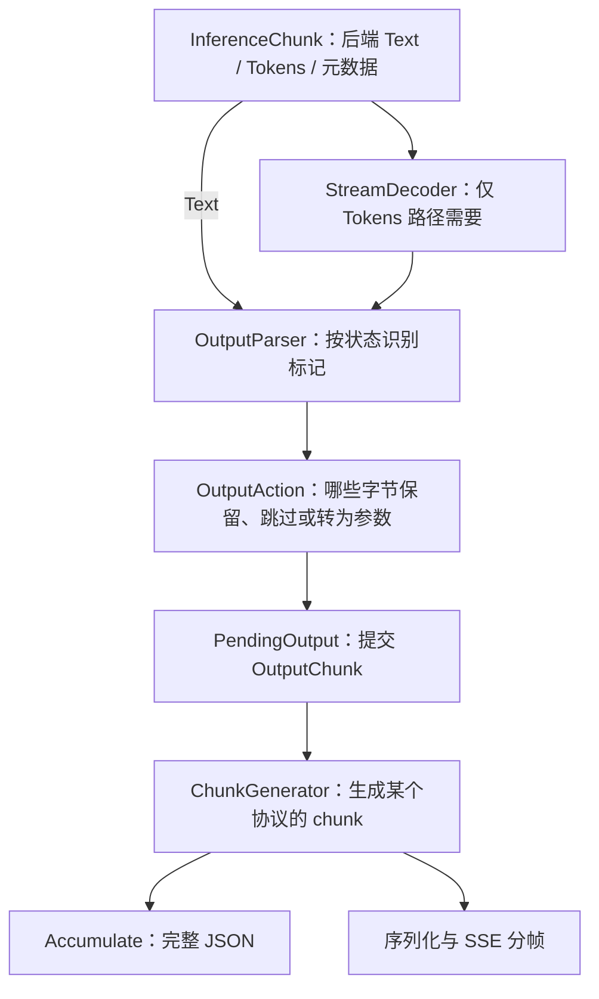
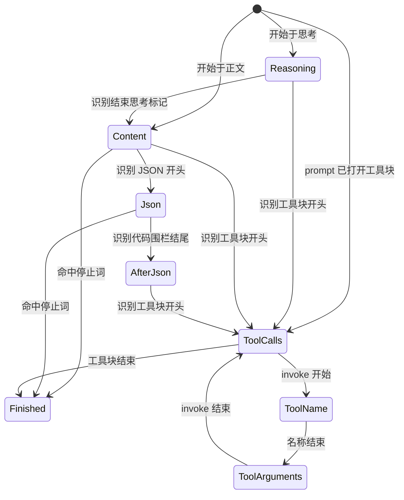

# 05 输出解析和 SSE：把片段变成响应

模型可能输出正文、思考文本和工具标记。它们还可能切成任意大小的片段。`StreamProcessor` 按顺序读取片段，必要时把 token IDs 解码成文本，再识别这些内容。协议生成器把解析结果转换成各 API 的事件。



SSE 是服务器在一条 HTTP 连接上按事件发送数据的方式。一个 SSE 事件不等于一个 token，也不一定对应一个后端片段。Chat Completions 可以发出角色、正文增量、结束信息和可选用量等事件。

## 先认识几个词

| 词 | 输入或输出在哪一层 |
| --- | --- |
| Chunk（片段） | 一次传递的数据单位。后端的 `InferenceChunk` 可以带文本、token IDs 或元数据。 |
| 增量解码 | 把陆续到达的 IDs 还原为文本。字符尚不完整时，decoder 可以先缓冲。 |
| Delta（增量） | 客户端用来更新状态的新内容。例如 Chat Completions 的 `delta.content`。 |
| Stop sequence（停止词） | 请求指定的字符串。在正文或已识别的 JSON 输出中匹配成功后结束输出，不把匹配内容写入正文；不匹配 reasoning 和工具标记。 |
| Finish reason | 协议报告的停止原因，例如达到预算、命中停止词或生成工具调用。 |

可以把同一个 `Hello world!` 看成三个不同层次的值。后端提供 `Text("Hello ")` 和 `Text("world!")`。Chat Completions 的生成器可以产生多条包含 `delta` 的 JSON。HTTP 层把每条 JSON 包为 `data: ...`，或者把它们合成一条完整消息。直接查 SSE 时，先看数据有无正确生成，再检查分帧。

## 为什么不能每收到一段，就原样发出去？

假设停止词是 `END`，后端先发 `Hello E`，再发 `ND ignored`。解析器要暂存可能属于停止词的 `E`。第二段到来后确认匹配，客户端只收到 `Hello `。如果下一段是 `cho`，此前暂存的 `E` 要正常输出。

读 [StreamProcessor](../deepseek-recipe/src/stream/processor.rs) 和 [OutputParser](../deepseek-recipe/src/stream/output_parser.rs)。先理解「等待更多输入」「确认是标记」「确认是普通文本」这三种情况，再看具体匹配代码。思考标记与工具标记也可能跨片段；在 token IDs 路径上，解析器还能区分显式特殊 token 和长得一样的普通文本。

## 分层：先确定是哪一种“片段”



图中的 `OutputAction` 是内部类型，不是公开调用接口。`OutputChunk` 表达共同语义，例如 Content、Reasoning、ToolCallNamed。Chat Completions 和 Messages 可以把同一个语义展开成不同数量的协议事件。

注意两个缓冲区的职责：decoder 等待字符能完整解码；parser 与 pending 等待能确定字节属于正文还是标记。前者解决字符边界，后者解决语义边界。将它们混在一起，容易把“丢字”和“吞标记”当成同一个问题。

## 状态机：同样的字符，为什么去不同字段？

状态机就是“记住当前正在读什么，再决定新输入怎么处理”。下面是主要状态的简化图，省略了空行与工具参数内部的小状态；只有启用相应选项时，JSON 和工具路径才可进入。



初始状态由请求转换决定，优先检查 `starts_in_tool_calls`，再检查 `thinking_initial_stage`，最后默认正文。这解释了两种容易困惑的现象：

- Prompt 已经以 `<think>` 结尾，后端只需继续输出思考文字，无需重复这个开头。
- 后端只发 `Hello world!`，若初始状态是 Reasoning，它就进入 `reasoning_content`；服务器不会根据文字像不像答案来猜测状态。

图中的 `Finished` 是解析器停止接受有效正文的状态。命中停止词会让 processor 提前停止消费上游；工具块结束则使后续文字被忽略，processor 仍可能继续读取直到后端 Finish 或流耗尽。不要把解析状态结束等同于 GPU 任务已经取消。源码见 [State 与 Stage](../deepseek-recipe/src/stream/output_parser.rs)、[processor 主循环](../deepseek-recipe/src/stream/processor.rs)。

### 跟踪跨片段的思考标记

运行下面的思考场景，最后一组输出应得到 reasoning `先思考` 和正文 `Hello world!`：

```sh
CARGO_TARGET_DIR=target cargo run --manifest-path tutorials/examples/Cargo.toml --locked -- thinking
```

| 新输入 Text | 当前判断 | 暂存 | 已确定的新内容 |
| --- | --- | --- | --- |
| `先思考` | 仍处于 Reasoning | 无未决标记 | reasoning `先思考` |
| `</th` | 可能是结束标记，尚未完整 | `</th` | 无 |
| `ink>Hello world!` | 完成标记，转到 Content | 无 | 正文 `Hello world!` |

表只展示语义结果，省略协议的起始与结束事件。如果输入直接结束在 `</th`，parser 会把未完成的候选按当前阶段的普通文本规则处理；它不能假装已经收到完整结束标记。

### 再跟踪停止词的成功与失败

关闭 thinking，停止词设为 `END`：

| 输入序列 | 决策 | 最终正文 |
| --- | --- | --- |
| `Hello E` → `ND ignored` | 暂存 E，随后匹配 END，停止 | `Hello ` |
| `E` → `cho` | 候选失败，释放原来的 E | `Echo` |
| `Hello E` → 后端 Finish | 候选未完成，收尾时释放 E | `Hello E` |

如果先在 Reasoning 阶段输出 `END`，它不会触发停止；必须先进入可匹配停止词的阶段。这由 [ParsingOptions.stop_sequences](../deepseek-recipe/src/stream/output_parser.rs)定义，不能仅凭字符串相同就认为行为应一致。

## Text 和 token IDs：不能忽略来源信息

比较同样显示为 `think</think> answer` 的三份输入：

| 传入方式 | 解析结果 |
| --- | --- |
| `Text` 字符串 | 按拼写识别标记：reasoning 为 `think`，正文为 ` answer` |
| 普通 token IDs 拼出整段文字 | 保留原意：整段仍在 reasoning 中 |
| `think` 的 IDs + 真正的结束思考 ID + ` answer` 的 IDs | 按特殊 ID 识别：reasoning 为 `think`，正文为 ` answer` |

`Text` 没有携带“普通 token 还是特殊 token”的信息，解析器只能按拼写识别。接入时，先了解上游提供了什么，不要认为将 IDs 解码成字符串后一定完全等价。

另一个例子是 `🤭` 在当前词表中由多个 ID 表示。只收到第一个 ID 时可能只能解出替换字符，decoder 会先等待；后续 ID 补齐后才输出完整字符。若流在不完整字符处结束，当前实现丢弃尚未解码的尾部 IDs，并不计入 completion usage。特殊 ID 插入到不完整字符后面的情形还有单独的 flush 行为，进阶时读 [decoder](../deepseek-recipe/src/stream/decoder.rs)。

这些边界有可运行检查：

```sh
CARGO_TARGET_DIR=target cargo test --manifest-path tutorials/examples/Cargo.toml --locked
```

在 [tests.rs](examples/tests.rs) 中找 `text_and_token_origins_change_marker_meaning` 和 `utf8_tokens_wait_for_a_complete_character`。先读断言，再看如何构造输入；不必一开始就理解解析器所有匹配算法。

## JSON 模式还做了什么？

`parse_json_output` 能识别 JSON 代码围栏，或从首次 `{` / `[` 进入 JSON 阶段。围栏之外的文字按来源 chunk 转为空格，**它不验证 JSON 语法或 JSON Schema**。因此应分别回答三件事：格式指令是否渲染、生成是否受约束、最终结果是否通过业务校验。第 06 章会继续追踪这三层。

## 跟读 Rust

从 `StreamProcessor::into_protocol_stream` 的 `match chunk` 开始。收到 `Text` 就得到文本片段，收到 `Tokens` 就调用 tokenizer 增量解码，保留显式特殊 token 的标记。然后对每个可处理的片段执行下面的源码。 [processor.rs](../deepseek-recipe/src/stream/processor.rs) · [decoder.rs](../deepseek-recipe/src/stream/decoder.rs)

```rust
let actions = parser.feed(&piece.content, piece.kind);
pending.push(piece.content, piece.logprobs);
for protocol_chunk in pending.apply_actions(actions, &mut generator).await {
    yield Ok(protocol_chunk);
}
```

`feed` 根据内容和当前状态决定要做什么，例如提交正文、切到思考或结束。`PendingOutput` 保存暂时不能发出去的内容，再按解析动作调用生成器。`&mut generator` 让方法借用并更新生成器状态。`yield` 出现在仓库使用的 `stream!` 宏内，表示把一个事件交给下游。

读完再看 `prepare_converted_response` 如何序列化并包装 SSE，以及 `complete_response` 如何累积这些增量。若正文已正确但缺少 SSE 终止事件，检查对应协议的 `sse_done_data` 和 `sse_event_name`。 [Rust 示例服务器](../server-rs/src/lib.rs)

## 练习：对比同一次停止在两种响应中的表现

用[入门导览](00-overview.md)里的默认示例服务器。若上一章的自定义后端还在运行，先在其终端按 Ctrl+C 停止，再启动原版服务，确认普通请求返回 `Hello world!`。

```sh
curl -sS http://127.0.0.1:7777/v1/chat/completions \
  -H 'Content-Type: application/json' \
  -d '{"model":"deepseek-flash","messages":[{"role":"user","content":"Hello"}],"thinking":{"type":"disabled"},"stop":"o wor","stream":false}'
```

停止词跨过 `Hello ` 和 `world!`。完整响应正文应为 `Hell`，`finish_reason` 为 `stop`。再把 `stream` 改成 `true`、给 `curl` 加 `-N`：拼接出现的 `choices[0].delta.content`，仍应得到 `Hell`，最后看到 Chat Completions 的 `data: [DONE]`。

没有示例服务器时，可以跑对应的 Rust 回归测试：

```sh
cargo test -p deepseek-recipe --locked a_stop_sequence_spanning_chunks_ends_output
```

如果两个模式解析结果一致，但只有 SSE 输出方式不对，先读 [server-py 的 response_body 和 sse_frame](../server-py/main.py) 或 [Rust 示例服务器](../server-rs/src/lib.rs)。如果正文在两种模式里都错，先检查解析器接到了哪些片段。

## 进阶：用量和终止事件

输入用量来自后端的 `Ready.prompt_usage`。文本输出按 `Text.token_count` 累计，token IDs 输出则由解码路径计数。仅凭屏幕上看见的正文长度无法还原用量，例如包含停止词的整段已处理 chunk 也计入 completion 用量。只有给 processor 附加 tokenizer 后，思考模式才能统计 `reasoning_tokens`。 [用量定义](../deepseek-recipe/src/stream/inference.rs)

本项目的 Chat Completions 最终 chunk 总会包含 usage，并保留结束 choice。设置 `"stream_options":{"include_usage":true}` 时，前面的 chunk 还会包含 `"usage":null`；设为 false 或省略时，前面的 chunk 省略 usage 字段。写客户端时应按这份实现核对，不要假设会另发一个空 choices 的用量事件。完整 JSON 会累积最终用量。 [流式生成器](../deepseek-recipe/src/protocol/openai/chat_completion/response/chunk_generator.rs)

要返回 `logprobs`（token 的对数概率），还需后端提供每个 token ID 对应的概率数据；数量不一致会触发 `LogprobCountMismatch`。概率来自后端，附加 tokenizer 的 processor 负责把它与解码内容一起交给协议生成器。 [token 解码说明](../docs/tokenizer.zh.md#解码)

| 协议 | 正常完成时客户端观察什么 |
| --- | --- |
| Chat Completions | 含 `finish_reason` 的结束 chunk，随后是 `data: [DONE]` |
| Responses | `response.completed` 事件，达到生成上限等情况可变成 `response.incomplete` |
| Messages | `message_delta` 报告 `stop_reason`，最终 `message_stop` |

这些事件由各自协议决定。若出错时 HTTP headers 已发送，服务不能再把原响应改成一个新的 JSON 400；客户端应处理流中断，服务端应记录错误并释放资源。 [三协议服务器测试](../server-py/tests/test_smoke.py) · [Responses 结束事件](../deepseek-recipe/src/protocol/openai/responses/response/chunk_generator.rs)

## 自测

停止词是 `END`，后端发来 `E`，下一段是 `cho`。未收到第二段之前能发出 `E` 吗？等第二段来之后应交给客户端什么？

<details>
<summary>参考答案</summary>

先暂存 `E`，因为它可能是停止词的开头。知道下一段是 `cho` 后，匹配失败，正文可包含完整的 `Echo`。这正是需要记住上一个片段状态的原因。

</details>

---

[上一章](04-inference-backend.md) · [课程目录](README.md) · [下一章](06-tools-and-structured-output.md)
