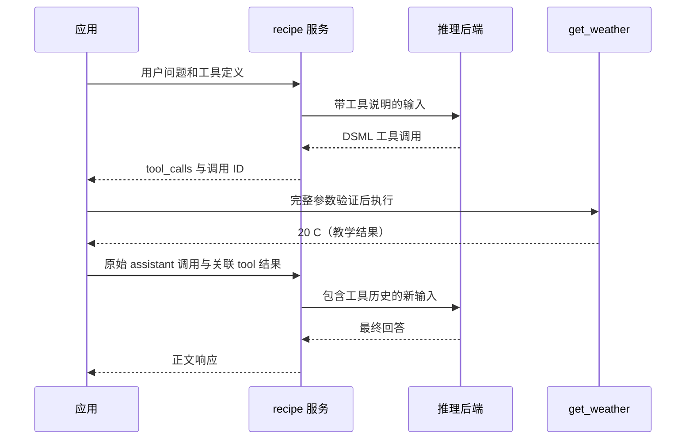

# 06 工具调用与结构化输出：怎么让模型返回可处理的数据

工具调用是模型提出的一次函数请求。应用把工具名、描述和参数结构交给模型。模型返回想调用的工具及参数，应用执行工具，再把结果带入下一轮。

```text
声明 get_weather(location) → 模板中的工具说明
         ↓
模型输出 DeepSeek 工具标记（DSML）
         ↓
项目解析为 tool_calls → 应用执行 → 带调用 ID 提交工具结果
```

## 先认识几个词

| 词 | 用天气查询理解 |
| --- | --- |
| Tool definition | 给模型看的工具说明，例如 `get_weather` 需要字符串参数 `location`。 |
| Tool choice | 规定模型能否调用工具，或是否必须调用，例如 `none`、`auto`、`required`。 |
| DSML | DeepSeek 在模型输入与输出中用来表示工具信息的标记格式。 |
| Tool call / tool result | 一次调用请求，以及应用执行后提交的结果。调用 ID 把两者关联起来。 |
| Constrained decoding（约束解码） | 生成每一步时根据规则限制可选 token，让结果符合指定格式。 |

假设客户端收到 `get_weather({"location":"Beijing"})`，调用 ID 为 `call_1`。它执行查询后，在下一轮保留那条 assistant 工具调用，再附上类似下面的 tool 消息。这里的温度是假定结果。

```json
{"role":"tool","tool_call_id":"call_1","content":"{\"temperature_c\":20}"}
```

返回给模型的是工具结果，最终给用户的自然语言回答可以由下一轮推理生成。

## 练习：在 Demo 中追踪一次天气查询

在新的浏览器标签页打开 [Demo](../encoding-decoding-demo/README.md)，选 **Chat Completions** 使用默认样例。这样可以获得初始的工具声明和示例输出，避免沿用上一章编辑过的纯文本请求。

1. 在 **Render** 查看默认 JSON。找到 `tools` 中的 `get_weather`，再在 prompt 中找出工具说明。
2. 在 **Parse** 查看手写的默认输出。找 `<｜DSML｜ invoke name="get_weather">`，并核对解析结果中的两组城市参数。Chat Completions 的 `function.arguments` 是 JSON 字符串，使用前需要解析。
3. 回到请求样例，在历史消息里找 `role: "tool"`。它的 `tool_call_id` 指向前一条助手消息里的调用。切换到 Messages，对照其中的 `tool_use` 和 `tool_result`。

这条路径涉及 [工具定义](../deepseek-recipe-core/src/tools.rs)、[V4.1 渲染](../deepseek-recipe-encoding/src/v4/dsv41.rs)和 [OutputParser](../deepseek-recipe/src/stream/output_parser.rs)。Demo 解析文本，不会查询天气。

## 看清一次调用的三种表示

先用单个城市，避免同时引入并行调用。下面是同一语义的三个层次：

| 层次 | 内容 | 谁会使用它 |
| --- | --- | --- |
| 业务函数 | `get_weather(location="Beijing")` | 应用自己的函数实现 |
| 模型输出 | DSML 的 invoke 与 parameter 标记 | OutputParser |
| 协议结果 | tool_calls 中的名称、ID、arguments 字符串 | 客户端的工具执行循环 |

示例模型输出如下。它是手写输入，不表示模型实际生成过这些文字：

```text
<｜DSML｜tool_calls><｜DSML｜invoke name="get_weather"><｜DSML｜parameter name="location" string="true">Beijing</｜DSML｜parameter></｜DSML｜invoke></｜DSML｜tool_calls>
```

第 05 章的状态机依次识别工具块、名称、参数名、字符串值。`string="true"` 让参数文本按 JSON 字符串转义；不能简单把所有参数原样粘到 JSON 中。协议的 `function.arguments` 最终是一个字符串，解析它才得到对象 `{"location":"Beijing"}`。



工具声明不会执行函数；模型输出调用也不会执行函数。只有图中的应用显式调用业务工具才会执行。应用应保留服务返回的调用 ID，不能只记一个函数名来配对多次调用。

### 不依赖浏览器的 Rust 往返练习

```sh
CARGO_TARGET_DIR=target cargo test --manifest-path tutorials/examples/Cargo.toml --locked tool_round_trip_preserves_arguments
```

该测试故意把 `get_weather` 切在 `get_` 后，把 Beijing 切成 `Bei`、`jing`。它断言完整函数名和参数，检查 `finish_reason=tool_calls`，再将返回的 assistant 消息与同一 ID 的工具结果放入第二轮渲染。

打开 [tests.rs](examples/tests.rs)先找这四个断言。验收目标是理解“片段可以不完整，执行工具必须等参数完整”，不是记住 DSML 每个字符。第二轮渲染成功只验证历史转换与模板，不表示 get_weather 已真实执行。

## 三件事不能混为一谈

| 环节 | 例子 | 由谁负责 |
| --- | --- | --- |
| 提示模型输出某种结构 | 把 JSON Schema 写进 prompt，请求返回对象 | 项目负责校验输入 schema 并按格式渲染 |
| 在生成时限制输出 | 只允许模型生成符合 schema 的后续 token | 项目提供 `OutputConstraint`；调用方决定后端是否执行 |
| 解析并使用结果 | 从 DSML 得到函数参数，或读取返回的 JSON | 项目处理协议解析；应用负责执行业务或验证所需的输出 |

`json_schema` 定义字段及类型，`regex` 用模式描述文本。两者都不能仅靠请求参数就证明后端一定执行了约束。工具启用时，[约束选择](../deepseek-recipe/src/protocol/output_constraint.rs)会优先选择工具调用约束，也会拒绝部分不支持的组合。排查时分开检查「转换得到的约束」「后端是否应用」和「原始输出与解析结果」。

## 跟读 Rust

先在 Chat Completions 的 `convert` 找 `convert_tools` 和 `parse_tool_calls`。前者把公开请求中的工具定义与选择方式转换为内部类型。后者进入解析选项，决定后续是否识别工具标记。开启工具时，约束选择函数校验 strict 等组合后，会走下面这条返回路径。 [请求转换](../deepseek-recipe/src/protocol/openai/chat_completion/request/convert.rs) · [约束选择](../deepseek-recipe/src/protocol/output_constraint.rs)

```rust
return Ok(Some(OutputConstraint::ToolCalls {
    tools: tools.to_vec(),
    required: tool_choice == ToolChoice::Required,
}));
```

`Result<Option<OutputConstraint>, ConversionError>` 表达三种结果。`Ok(Some(...))` 表示选择了约束，`Ok(None)` 表示可以继续但没有约束，`Err(...)` 表示请求组合有误。这里的 `required` 表示约束要求至少一次工具调用，实际执行取决于引擎接入。

最后读 V4.1 的 `render_tool_prompt` 和 `render_tool_calls`，对照 Demo 看工具定义和历史调用怎样进 prompt。在输出侧看 Chat Completions 生成器如何把解析出的工具信息写进 `tool_calls`。 [V4.1 模板](../deepseek-recipe-encoding/src/v4/dsv41.rs) · [Chat Completions 生成器](../deepseek-recipe/src/protocol/openai/chat_completion/response/chunk_generator.rs)

## 练习：看清 JSON Schema 在哪一步起作用

在 **Render → Chat Completions** 用下面的 JSON 替换默认请求。在 prompt 中找 `Response Format` 和 `greeting`。这一步只能确认 schema 已进入模型输入。

```json
{
  "model": "deepseek-flash",
  "messages": [{"role": "user", "content": "用 JSON 返回一句问候。"}],
  "thinking": {"type": "disabled"},
  "response_format": {
    "type": "json_schema",
    "json_schema": {
      "name": "greeting_result",
      "strict": true,
      "schema": {
        "type": "object",
        "properties": {"greeting": {"type": "string"}},
        "required": ["greeting"],
        "additionalProperties": false
      }
    }
  }
}
```

`{"greeting":"Hello"}` 符合此 schema，`{"greeting":123}` 不符合。要确认生成时会排除后者，用启用了约束解码的真实后端验证，并按应用需要校验最终输出。

### 反例：解析成功不代表符合 schema

配套回归测试把 `{"greeting":123}` 交给声明 greeting 必须为 string 的请求。当前解析器仍能返回这段正文，因为它负责输出结构解析，不执行 schema 验证：

```sh
CARGO_TARGET_DIR=target cargo test --manifest-path tutorials/examples/Cargo.toml --locked json_output_parsing_does_not_validate_the_schema
```

这个测试通过说明职责边界符合预期，不说明错误类型值被接受为正确业务数据。接入方仍需确保后端执行约束，并按需要验证结果。

## 进阶：一次完整的工具往返

以下是第二轮请求。它保留用户问题、上一轮助手的工具调用和应用的工具结果。用 Demo 的 Render 可以看到这些历史如何进入下一轮 prompt。温度是假定结果，`call_1` 是教学 ID，实际应用应原样保留服务返回的调用 ID。

```json
{
  "model": "deepseek-flash",
  "thinking": {"type": "disabled"},
  "messages": [
    {"role": "user", "content": "北京现在多少度？"},
    {"role": "assistant", "content": "", "tool_calls": [
      {"id": "call_1", "type": "function", "function": {
        "name": "get_weather", "arguments": "{\"location\":\"Beijing\"}"
      }}
    ]},
    {"role": "tool", "tool_call_id": "call_1", "content": "{\"temperature_c\":20}"}
  ],
  "tools": [{"type": "function", "function": {
    "name": "get_weather",
    "description": "查询城市气温",
    "parameters": {
      "type": "object",
      "properties": {"location": {"type": "string"}},
      "required": ["location"]
    }
  }}]
}
```

开启思考模式后，工具往返还需处理助手的 `reasoning_content`。默认 `FillEmpty` 会把缺失值补成空字符串，配置为 `Reject` 时，最后一轮符合条件的工具上下文缺失 reasoning 会被拒绝。生成器还会在「没有产生思考内容」的工具 ID 中写入标记，因此原样保留返回的助手消息和 ID 比自行重建更稳妥。具体条件见源码。 [历史 reasoning 归一化](../deepseek-recipe/src/protocol/reasoning_content.rs) · [工具 ID](../deepseek-recipe/src/protocol/tool_call_id.rs)

流式工具参数也按增量到达。等调用参数完整后再解析和执行，并在应用层处理参数错误、工具失败和重试。工具实际权限与执行属于调用应用的职责。

## 自测

调用方只把 prompt 发给引擎，没有传入 `OutputConstraint`，模型返回 `{"greeting":123}`。即使请求声明了字符串字段，应该去哪一层查？

<details>
<summary>参考答案</summary>

先确认转换产出的 schema 约束和引擎实际收到的参数。只传 prompt 时，引擎收到了格式指令，但是否启用约束取决于调用方。应用处理结果前还可以按业务需要独立校验。

</details>

---

[上一章](05-streaming-response.md) · [课程目录](README.md) · [下一章](07-image-input.md)
