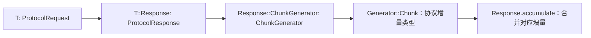
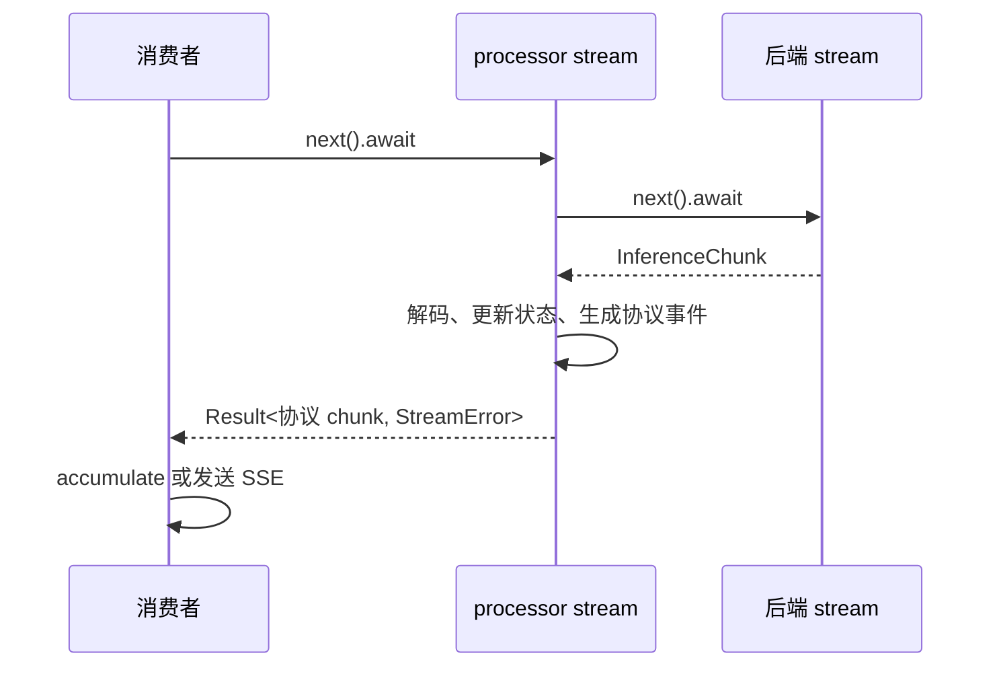

# 09 Rust 实践：从看懂语法到读懂项目设计

**学习位置：** 可以在第 01 章后读前两节，完成第 05 章后再读异步部分。只需 Rust 工具链和 C/C++ 编译器；配套练习无需 HTTP 服务、Python 或 OpenCV。

本章围绕同一个问题：怎样让一套 Rust 流程安全地处理不同协议的请求与响应？先认清“值由谁持有”和“类型如何对应”，再理解异步执行。

## 1. 所有权：数据现在归谁？

`String`、`Vec` 等值拥有自己的数据。函数参数可以取得所有权，也可以借用已有值。先用项目中的三种签名建立直觉：

| 形式 | 含义 | 本项目中的用途 |
| --- | --- | --- |
| `convert(self, ...)` | 消耗请求值，把它移入转换过程 | 字符串、消息等字段可被移到内部结构 |
| `render_conversation(&Conversation)` | 临时只读借用 | 渲染完，调用方仍可编码同一份对话 |
| `generate(&mut self, ...)` | 临时独占可变借用 | 更新协议生成器的事件状态 |

“move”不会自动深拷贝一份字符串；需要复制内容时才显式 `clone()`。也不要为了让编译通过就给所有值 clone，先确认谁应该拥有数据。概念背景见 [Rust Book：Ownership](https://doc.rust-lang.org/book/ch04-01-what-is-ownership.html)。

看 [main.rs](examples/main.rs)中的顺序：

```text
request.convert(...) 取得原始请求
    ↓
converted 持有 ConversationRequest
    ├─ &converted.conversation 被渲染器借用
    ├─ &converted 被 chunk_generator 借用
    └─ converted.parsing_options 被移入 StreamProcessor
```

最后一步是字段的部分移动。之后不能再借用整个 `converted`；没有被移动且允许访问的其他字段仍可能可用。将 generator 的构造放在移动 parsing_options 之前，正是为了让整个请求先被完整借用。

### 练习：理解一个编译错误

在 `collect_response` 中，用下面的片段替换最初构造 generator 和 processor 的两条语句。**这是故意不能编译的实验片段**，其余函数保持不变：

```rust
let parsing_options = request.parsing_options;
let generator = ChatCompletionRequest::chunk_generator(
    &request, "tutorial-id".into(), MODEL.into(),
);
let mut processor = StreamProcessor::new(generator, parsing_options);
```

运行下方命令，应看到 `E0382`：先移动 parsing_options 后，又借用了完整 request。观察错误后恢复原来的两条语句，再确认命令通过。

```sh
CARGO_TARGET_DIR=target cargo check --manifest-path tutorials/examples/Cargo.toml --locked
```

验收：能解释移动的是哪个字段、后面的调用为什么需要完整请求，以及为什么调整顺序足够。无需给 ConversationRequest 增加 Clone 实现。

## 2. trait 与关联类型：一条请求配哪一种响应？

`trait` 描述接口；泛型参数 `T` 表示“具体是哪种类型，调用时再确定”；关联类型表示“实现这个接口时，同时指定一个配套类型”。

项目的关系是：



源码入口是 [ProtocolRequest](../deepseek-recipe/src/request/mod.rs)、[ProtocolResponse 与 Accumulate](../deepseek-recipe/src/response.rs)、[ChunkGenerator](../deepseek-recipe/src/stream/mod.rs)。以 Chat Completions 为例，具体实现把请求、完整响应和增量生成器连接起来。

遇到这个复杂类型时，分三次读：

```rust
<<T::Response as ProtocolResponse>::ChunkGenerator as ChunkGenerator>::Chunk
```

1. `T::Response`：T 对应的完整响应类型。
2. `as ProtocolResponse`：通过响应接口取它的 ChunkGenerator。
3. `as ChunkGenerator`：通过生成器接口取每一条 Chunk 的类型。

因此 `complete_response<T>` 不必为三种协议复制三份累积循环。`where` 子句列出的能力要求让编译器检查“能生成、能发送、能序列化”等条件。它保证类型配套，不会替你检查所有运行时语义；传给辅助函数的 ConversationRequest 仍应来自对应的 `T::convert`。

## 3. 完整跟读一个函数

下面是配套练习 `collect_response` 的完整函数，属于**教学实现**，直接使用库的真实 API。它与服务器的 `complete_response<T>` 思路相同，但固定为 Chat Completions，并允许附加 tokenizer、打印事件。

```rust
async fn collect_response(
    request: ConversationRequest,
    chunks: Vec<InferenceChunk>,
    tokenizer: Option<Tokenizer>,
    print_events: bool,
) -> TutorialResult<Value> {
    let generator =
        ChatCompletionRequest::chunk_generator(&request, "tutorial-id".into(), MODEL.into());
    let mut processor = StreamProcessor::new(generator, request.parsing_options);
    if let Some(tokenizer) = tokenizer {
        processor = processor.with_tokenizer(tokenizer);
    }
    let mut response = <ChatCompletionRequest as ProtocolRequest>::Response::new(
        "tutorial-id".into(),
        MODEL.into(),
        0,
        0,
        0,
    );
    let mut stream = std::pin::pin!(processor.into_protocol_stream(iter(chunks)));
    while let Some(chunk) = stream.next().await {
        let chunk = chunk?;
        if print_events {
            println!("协议 chunk = {}", serde_json::to_string(&chunk)?);
        }
        response.accumulate(chunk);
    }
    Ok(serde_json::to_value(response)?)
}
```

按四段理解，不必逐字背诵类型：

| 代码段 | 完成的工作 | 为什么需要这一步 |
| --- | --- | --- |
| 建 generator 与 processor | 连接协议与解析选项 | processor 识别共同语义，generator 负责协议格式 |
| 可选 with_tokenizer | 为 Tokens 路径安装解码器 | Text 路径可以不解码，IDs 路径必须能解码 |
| 建 response 与 stream | 准备累积目标和异步输入 | Vec 只是固定测试输入，真实后端会逐步到达 |
| while 循环 | 读取结果、传播错误、累积增量 | 使用协议自己的累积实现，不手写字段拼接 |

`TutorialResult<T>` 是 `Result<T, Box<dyn Error + Send + Sync>>` 的教学别名。将多种错误放进 Box，便于示例用 `?` 串联；核心库仍使用 `ConversionError`、`StreamError` 等明确的错误类型，供调用者分类处理。

## 4. Option 与 Result：缺省值不同于失败

`Option<T>` 说明一个值可能没有。例如 `max_tokens: None` 是合法的“没有指定”，可以稍后选择默认值。`Result<T, E>` 说明一次操作可能失败。

第 06 章出现的 `Result<Option<OutputConstraint>, ConversionError>` 有三条路径：

| 值 | 下一步 |
| --- | --- |
| `Ok(Some(constraint))` | 携带约束继续 |
| `Ok(None)` | 无约束继续 |
| `Err(error)` | 停止当前转换，处理错误 |

`?` 只传播失败，不等于返回 400。HTTP 状态码由服务层映射；而流式响应已经发出 headers 后，错误也不能再变成新的 JSON 状态响应。看 `api_handler` 的 [map_err(http_error)](../server-rs/src/main.rs)和 processor 的 [StreamError](../deepseek-recipe/src/stream/mod.rs)。

试运行 `token_chunks_require_a_tokenizer`，它验证类型正确的 Tokens 输入仍可能因缺少运行配置而失败：

```sh
CARGO_TARGET_DIR=target cargo test --manifest-path tutorials/examples/Cargo.toml --locked token_chunks_require_a_tokenizer
```

## 5. Future、Stream、await：谁推动处理过程？

`Future` 最终产生一次结果；`Stream` 可以依次产生多项。`.next().await` 等待下一项，得到 `Some(item)` 后处理，得到 `None` 时结束。

创建 stream 不等于把所有结果提前算好。消费者持续读取，异步流程才持续推进；`.await` 本身也不等于启动新线程。运行时负责在任务需要等待时安排其他工作。参见 [Rust Book：异步相关 traits](https://doc.rust-lang.org/book/ch17-05-traits-for-async.html)。



图展示一次推进的概念过程；一个后端片段可以生成零条、多条协议事件，不能假定两个 next 一一对应。

### Pin 和 Unpin 为什么在这里出现？

异步状态可能在多次等待之间引用自身的数据，需要保证被固定的值不再移动。`pin!` 给局部流建立安全的固定借用，之后可通过它调用 `next()`。`Unpin` 则表示某个类型不依赖这样的固定位置约束。这里沿用安全 API 即可，不需要手写 unsafe 或实现 Future。

### Send、Sync、'static 分别限制什么？

| 约束 | 初学者应理解的含义 |
| --- | --- |
| `Send` | 值的所有权能安全地在线程之间转移 |
| `Sync` | 可以安全地从多个线程持有这个值的共享引用 |
| `T: 'static` | 类型不包含借用期过短的引用；不意味着值必须永远不销毁 |

`Arc` 支持共享所有权，clone Arc 通常只增加引用计数；它不会自动让内部可变数据变得可并发修改。项目把 tokenizer 或特殊标记配置共享给多个处理器时，可看到这种写法。`Send/Sync` 的详细边界见 [Rust Book](https://doc.rust-lang.org/book/ch16-04-extensible-concurrency-sync-and-send.html)。

## 6. 流结束，是否等于资源释放？

消费者不再读取时，上游不一定已经停止。直接持有的 Rust 资源会按所有权在销毁时释放；但如果适配器另外启动了后台任务、网络请求或 GPU 任务，还必须安排取消和收尾。一个标记为 `Send` 的 stream 并不自动获得这些能力。

处理速度差异还会带来 backpressure（背压）：下游慢时，不能无限堆积上游数据。当前拉取式接口给了控制读取节奏的边界；真实接入若额外使用队列，还要设计容量、阻塞或拒绝策略。第 10 章用提前关闭迭代器的实验来观察清理。

## 自测与验收

完成后，应能独立回答：

1. 为什么 `convert(self)` 之后不能继续使用原始 request？
2. 为什么调用 generator 后才移动 parsing_options？
3. 改用另一种协议，为什么累积循环可以保持相同结构？
4. `.await`、`Send`、`Pin` 是否分别代表创建线程、并行运行和永久分配？
5. 停止消费流后，适配器自行创建的后台任务由谁取消？

<details>
<summary>参考答案</summary>

1. 原请求的所有权已交给转换函数。2. generator 的接口先借用整个请求，部分移动后不能再这样借用。3. 关联类型把请求、响应、生成器和 chunk 配套，循环只依赖共同接口。4. 都不是；它们分别涉及等待、跨线程转移的安全约束和固定位置保证。5. 由创建并持有任务的接入方明确处理，库不能代替未知后端取消任务。

</details>

---

[上一章](08-contributing.md) · [课程目录](README.md) · [下一章](10-backend-adapter.md)
