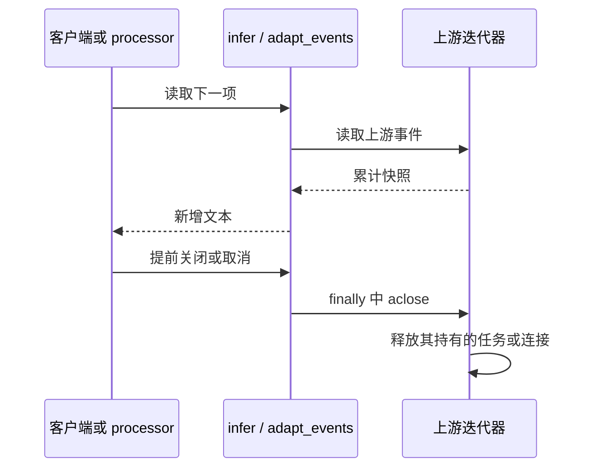

# 10 后端适配实战：把上游输出接成项目需要的流

**先修：** 第 03、04、05 章。基础实验仅需 Python 3.10+ 与标准库；可选 HTTP 练习另需项目的 Python bindings、OpenCV 和服务器依赖。用 Python 是为了复用已有 `create_app(infer=...)` 注入点，Rust 的对应边界仍是 `InferenceChunk` 与 `into_protocol_stream`。

本章先完成一个可验证的适配器，再说明接真实引擎需要补什么。固定样本没有运行模型，也不代表任何具体引擎版本的兼容性。

## 1. 先约定上游到底提供什么

本例假设上游提供“累计文本”和“累计生成 token 数”。同一请求的文本只能向后追加，计数不能回退；结束原因单独提供。真实引擎可能采用其他契约，必须先转换到本例契约或另写适配逻辑。

| 上游事件 | 数据 | 我们要产出的事件 |
| --- | --- | --- |
| ready | 输入 token 数为 5 | Ready，输入用量 5 |
| snapshot | `Hel`，累计 1 | Text `Hel`，本段用量 1 |
| snapshot | `Hel`，累计 1 | 重复快照，不产生新文本 |
| snapshot | `Hello`，累计 3 | Text `lo`，本段用量 2 |
| finish | stop | Finish Stop |

这里的 1、3 是教学数据，不是对 `Hel`、`Hello` 的实际分词测量。增量用量是 `3 - 1 = 2`，不能拿新字符串的字符数代替。

本适配器要求 ready 在前、finish 在后，比核心库更严格。核心库允许缺少 Ready，并可在 EOF 时生成 EndOfStream；本例选择拒绝缺少显式结束的上游，目的是及早暴露传输中断，而不是宣称库本身会报错。

## 2. 先运行，再跟读

```sh
python3 tutorials/examples/backend_adapter.py
python3 -m unittest discover -s tutorials/examples -p test_backend_adapter.py -v
```

第一条打印四个归一化事件：ready、Text `Hel`、Text `lo`、finish。第二条执行 9 个测试，包括累计内容与计数、三种结束原因、异常、EOF、提前关闭和取消。

[backend_adapter.py](examples/backend_adapter.py) 的 `adapt_events` 是一个异步生成器。外层每次取一项，它就继续向上游取数据并推进处理。累计值留在函数局部变量里，跨多次等待保留。

下面是源码节选：

```python
delta = text[len(previous_text):]
token_delta = tokens - previous_tokens
previous_text, previous_tokens = text, tokens
if delta or token_delta:
    yield {"kind": "text", "content": delta, "token_count": token_delta}
```

这段代码前面有两项必要检查：新文本必须以旧文本开头；新的累计 token 数不能小于旧值。否则“截去相同字符数量”没有可靠含义。例如上游把 `Hello` 改写成 `Hallo`，直接切片会悄悄保留错误内容，本例会报错。

如果上游在每次快照中改写未完成字符、回退 speculative tokens，或给出累计解码修订，它就不满足这个教学契约。应根据该引擎的输出语义处理，不能只删掉校验来使实验通过。

## 3. 为什么清理也属于适配逻辑？



`adapt_events` 在 `finally` 中关闭 source；调用它的 `infer` 用 `aclosing` 明确关闭适配器。这两层都重要：调用者收到 Finish 后可能立即停止取下一项，生成器仍停在 yield 位置，不能指望自动继续执行后面的 return 和 finally。

[清理测试](examples/test_backend_adapter.py)用 `audit` 记录 source 的 finally 是否运行。正常结束、上游错误、主动 aclose、等待期间取消，都应留下 `closed`。这证明教学迭代器执行了清理，不能证明一个未知 GPU 引擎已释放显存。

真实后端若在清理时还要 await 网络取消，需要按所用运行时处理取消保护与超时。当前 Python 服务器保护显式 aclose 调用，但后端内部异步清理仍由自己负责。参见 [response_body 与 InferenceStreamingResponse](../server-py/main.py)。

## 4. 可选：接入现有 HTTP 示例

这一步需要先完成 [Python 服务器安装](../server-py/README.md#usage)。本轮仅核对桥接代码与 bindings 声明，未在缺少这些依赖的环境中端到端运行。

停止占用 7777 的其他示例后，从仓库根目录执行：

```sh
PYTHONPATH=server-py python3 -m uvicorn adapter_app:app --app-dir tutorials/examples --host 127.0.0.1 --port 7777
```

`adapter_app.py` 引入仓库的 create_app，将教学 infer 交给它。infer 延迟导入 `deepseek_recipe`，因此前面的离线实验不需要安装 native 模块。

```sh
curl -sS http://127.0.0.1:7777/v1/chat/completions \
  -H 'Content-Type: application/json' \
  -d '{"model":"deepseek-flash","messages":[{"role":"user","content":"Hello"}],"thinking":{"type":"disabled"},"stream":false}'
```

预期正文是 `Hello`，教学输入用量为 5，生成用量为 3。再用 `stream:true` 和 `curl -N` 检查正文增量拼接仍为 Hello。此 fixture 只演示普通非思考文本；它不使用 prompt 生成回答，不验证工具、JSON Schema 或图片能力。

## 5. 换真实引擎前，先完成输入交接

适配输出只是后半段。前半段必须把本项目的结果正确送给引擎：

| 项目提供什么 | 接入方必须确认什么 |
| --- | --- |
| `model_version` | 实际加载的权重是否支持对应模板；别名不会加载权重 |
| `Conversation` / RenderedPrompt | 引擎接收原始 token IDs 还是文本；模板应只应用一次 |
| `special_ranges` | 自行编码时使用匹配的 PromptTokenizer；只拿 prompt 字符串可能丢来源信息 |
| `resolve_max_tokens` 返回值 | 把最终返回值映射到引擎的生成上限字段 |
| temperature、top_p、seed | 映射转换后的有效值，确认引擎对应参数及限制 |
| `OutputConstraint` | 明确支持、执行或拒绝；不能无声忽略却声称已约束生成 |
| 图片数据及 adjustment | 按占位符顺序传图，并按目标模型约定计入预算 |

Python `PreparedRequest` 保留了 `conversation_request`，但不单独保留 special_ranges。要在回调里自行编码，可以从对应模型的 encoding 对 Conversation 调用 encode；不要把已经渲染的字符串再当作一条 user 消息套模板。

真实请求的生成顺序应为：

```text
确认权重/模板/tokenizer 配套
→ 编码与图片预处理
→ 计算输入用量和生成预算
→ 构造引擎请求（采样与约束）
→ 消费原始增量，映射用量与结束原因
→ processor → 协议响应
```

上游发生错误时，不能为了完成响应而转换成普通 Stop。当前 InferenceChunk 没有通用 Error 变体，调用方要通过自己的错误路径中止 HTTP/异步处理，并记录上游原因。对于 Tokens 终止输出，还应遵守第 04 章说明的 Length 与其他结束原因的差异。

## 6. 留下一份能复查的接入记录

真实后端部分是接入指南，尚无本教程验证过的引擎组合。运行时记录下面的信息，之后才有依据讨论“已经接通”：

| 记录项 | 具体内容 |
| --- | --- |
| 版本 | recipe commit、引擎版本、模型权重 revision、tokenizer 来源 |
| 环境 | GPU、驱动、运行方式、上下文上限 |
| 输入证据 | 脱敏请求、渲染结果或 IDs、最终采样参数和预算 |
| 输出证据 | 引擎原始事件、结束原因、完整 JSON 与 SSE |
| 结果范围 | 普通文本、thinking、工具、结构约束、图片各自是否实际验证 |

先验证一个短的非思考请求，再加 thinking、停止词与异常取消。最后按后端真实支持范围验证工具和图片。无需为了跑通普通文本就一次启用全部功能。

## 自测与独立练习

1. 把末尾 finish 改为 length，确认事件及 HTTP 响应的结束原因没有被改成 stop。
2. 删除 finish，解释为什么适配器报错，而裸用核心库可能得到 EndOfStream。
3. 把累计文本改为 `Hel → Hello → Hallo`，先预测结果，再运行测试。
4. 独立增加一种“每次已经是增量”的上游样本。不要再做累计切片；仍验证用量、结束和关闭。

验收：能输出正确正文、保留结束原因、拒绝违反输入契约的数据，并证明消费者提前结束时执行了清理。真实 GPU 资源的释放要另用对应引擎的观测手段确认。

---

[上一章](09-rust-practice.md) · [课程目录](README.md) · [下一章](11-inference-principles.md)
