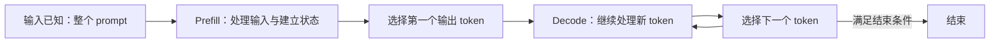

# 11 推理原理与性能：从 API 字段走到模型生成

**学习位置：** 第 03、04 章之后可阅读。数学只用概率、加减法和时间差；本章代码仅用 Python 标准库。所有概率和时间数字都是教学样例，不是本仓库或某个模型的性能测量。

本项目把请求送到模型前、把输出带回客户端。这一章补齐中间“模型怎样生成”的概念，帮助你判断问题属于转换层、解析层还是引擎侧。

## 1. 自回归：为什么一个 token 接一个 token？

训练后的因果语言模型可以根据已有上下文，为下一个 token 给出一组分数，称为 logits。选择一个 token 后，把它作为后续上下文的一部分，再继续预测。分数来自模型权重计算，不是 tokenizer 查词表的结果。

```text
prompt IDs
  → 模型计算 → 候选分数 → 选择第 1 个 ID
  → 结合新 ID 继续计算 → 选择第 2 个 ID
  → …… → EOS、预算上限或其他结束条件
```

Tokenizer 负责文本与编号的转换；模型负责预测；采样策略负责从候选中选择；引擎组织计算和资源。项目里的 InferenceOptions 用来传递部分生成要求，mock 并没有执行这些计算。生成策略的背景见 [Transformers 官方说明](https://huggingface.co/docs/transformers/main/generation_strategies)。

### EOS、max_tokens、stop 是同一个东西吗？

| 条件 | 本课程中谁处理 | 会观察到什么 |
| --- | --- | --- |
| 模型生成 EOS | 引擎按模型约定判断并报告结束 | 后端 Finish，适配器需正确处理终止 token |
| 达到生成预算 | 引擎执行实际传入的输出上限 | 通常映射为 Length |
| 正文命中请求 stop | 本项目解析器识别；后端也可能有自己的机制 | processor 停止继续消费，并报告 StopSequence |

它们会经过协议映射，所以客户端的 `finish_reason` 不一定保留全部内部区别。第 04、05 章已经展示了内部原因与协议原因的差异；排障时保留两者。

## 2. 采样：temperature 与 top_p 改变了什么？

假设模型为三个候选 A、B、C 给出 logits `[2, 1, 0]`。先不考虑其他采样规则。在正数 temperature `T` 下，可以用 `softmax(logits / T)` 得到分布：

| T | A | B | C | 直观结果 |
| --- | --- | --- | --- | --- |
| 0.5 | 0.867 | 0.117 | 0.016 | 更集中于最高分候选 |
| 1.0 | 0.665 | 0.245 | 0.090 | 原始 softmax 分布 |
| 2.0 | 0.506 | 0.307 | 0.186 | 分布更平缓 |

这些是按教学 logits 算出的数，并不说明高 temperature 一定更聪明、低 temperature 一定正确。选择候选的随机性和回答事实正确性是不同问题。

`top_p` 则先按概率排序，保留累计概率达到阈值的最小候选集合，再在其中采样。以上 T=1 时，`top_p=0.8` 保留 A 和 B，累计约 0.910；不是“只允许 80% 的词表”。采样参数定义可对照 [GenerationConfig](https://huggingface.co/docs/transformers/main_classes/text_generation)。

### 不加载模型，自己算一次

```sh
python3 - <<'PYTHON'
import math

logits = [2.0, 1.0, 0.0]
for temperature in (0.5, 1.0, 2.0):
    weights = [math.exp((x - max(logits)) / temperature) for x in logits]
    probabilities = [x / sum(weights) for x in weights]
    print(temperature, [round(x, 3) for x in probabilities])
PYTHON
```

减去最大 logit 不改变归一化后的结果，却避免不必要的大指数值。这个程序只计算分布，不模拟神经网络。

再回到项目：在 thinking 模式，转换器把 temperature 设为 1.0；V4.1 非思考模式的 top_p 被设为 1.0。因此请求值、转换值、引擎值三处都应核对。不能用本章的任意参数组合推断当前模型接口支持它。

## 3. Prefill 与 Decode：同一次请求的两个阶段

Prefill 处理已知的 prompt，建立后续生成需要的状态，并得到选择首个输出 token 所需的信息。Decode 继续处理新生成的 token，一步步产生后续输出。



输入变长和输出变长会增加不同阶段的工作。输入很长、只答一句话，与输入很短、生成长文，不能仅按请求数量比较负载。Prefill/Decode 的资源需求和相互干扰是服务引擎的重要问题，[DistServe](https://www.usenix.org/conference/osdi24/presentation/zhong-yinmin)专门研究了它们的分离与延迟目标。本仓库没有实现这种 GPU 调度。

## 4. KV cache：保存什么，省下什么？

在典型的因果自注意力中，新位置需要查询前面位置的信息。Query 可理解为当前“要找什么”，Key 帮助判断相关性，Value 提供要汇聚的信息。KV cache 保存已处理位置的 Key/Value，使生成后续 token 时可以复用，而不必反复计算相同的历史部分。参见 [Transformers：Caching](https://huggingface.co/docs/transformers/main/cache_explanation)。

```text
处理 prompt 后：历史位置的 K/V 已缓存
新增一个 token：计算新位置所需的数据，复用历史 K/V
继续生成：缓存随序列推进，具体组织由模型与引擎决定
```

它仍然占用内存，也没有消除每一步所有的模型计算。缓存布局和大小取决于模型架构、精度及实现；本章不把普通注意力的估算公式直接套在 DeepSeek 特定架构上。

三个名字容易混淆：

| 名称 | 复用的是什么 | 是否意味着可以直接返回旧答案 |
| --- | --- | --- |
| KV cache | 生成过程的注意力状态 | 否 |
| Prefix / prompt cache | 相同输入前缀对应的可复用状态，是否支持由引擎决定 | 否，后续仍可继续生成 |
| Response cache | 应用保存的完整回答 | 可能，但这是另一种策略 |

项目里的 `prompt_cache_hit_tokens` 是由后端提供的统计，不代表这个 Rust 库自己实现了共享 KV cache。

## 5. 延迟：第一个字慢，与后面的字慢

用同一客户端的单调时钟记录时间，假设真正输出了 4 个 token，分别在 100、130、160、190 ms 到达：

```text
发起请求 0 ms
  └─ 输入准备 / 排队 / prefill / 传输
首 token 100 ms → 第 2 个 130 → 第 3 个 160 → 第 4 个 190
```

- TTFT = `100 - 0 = 100 ms`。
- 本例的平均 TPOT = `(190 - 100) / (4 - 1) = 30 ms/token`。
- 首 token 后的生成速率约为 `1000 / 30 = 33.3 token/s`。
- 从发起到最后 token 的整体输出速率约为 `4 / 0.190 = 21.1 token/s`。

后两个数不同，因为观察区间不同。只有一个输出 token 时，上面的 TPOT 分母为零，应记为不适用。首个 SSE 可能只有 role 或元数据，也可能一次包含多个 token；不能把“收到第一个 SSE”或“SSE 间隔”直接当作精确 token 指标。若引擎只有批量片段，应明确记录的是片段指标。

### 最少记录哪些时间点？

| 时间点 | 帮助区分什么 |
| --- | --- |
| 服务收到请求 | 客户端网络与服务内耗时的起点差异 |
| 转换、渲染、图片准备完成 | 输入准备是否慢 |
| 提交引擎、引擎开始执行 | 是否主要在排队，需要引擎侧时间信息 |
| 首次模型输出、首次正文发出 | thinking 或解析缓冲是否推迟了可见正文 |
| 后端结束、响应结束 | 收尾或传输是否继续占用时间 |

“首个模型 token”和“用户看到第一个正文 token”也是不同指标，thinking 模式下尤其明显。使用同一 request ID 关联这些记录，不必记录私有完整 prompt。

## 6. 吞吐、并发与后续学习方向

吞吐描述单位时间完成多少工作；并发描述同时处理多少请求。两者不等价。批处理让多个请求共享计算机会，但排队、内存与调度策略也会影响单个请求的延迟。不能仅凭 mock 快速返回就估计真实吞吐。

接下来可以学习 continuous batching、KV cache 内存管理、量化与多设备并行。先明确每项优化针对哪种瓶颈，再比较相同输入/输出长度分布、并发、缓存条件和硬件下的结果。本教程不要求初学者先掌握 GPU kernel 开发。

## 自测与验收

1. 输入从 500 token 增加到 5000，但只输出 5 token。先分析哪个阶段？
2. TTFT 很大，后续生成很快。仅调 top_p 能确定解决问题吗？
3. SSE 的第一条只有 role，能把它当第一个模型 token 吗？
4. 命中 prompt cache 后，是否必然返回相同答案？
5. 当前 V4.1 非思考请求设置 top_p=0.8，应该先看哪一层的实际值？

<details>
<summary>参考答案</summary>

1. 先看输入准备、排队与 Prefill 的分段耗时，不能仅凭总耗时断定原因。2. 不能，应先测量时间分布。3. 不能，事件不等于 token。4. 不必然，复用输入状态不等于缓存最终回答，采样和后续输入仍会影响结果。5. 先看转换后的 InferenceOptions，再核对后端收到的值；当前转换规则会覆盖为 1.0。

</details>

---

[上一章](10-backend-adapter.md) · [课程目录](README.md)
